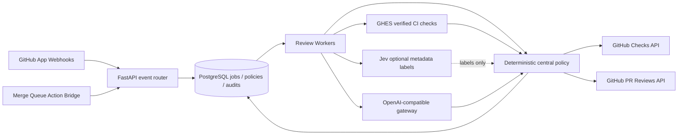

# Central Review Engine architecture

## Boundaries

- **Source of truth:** GitHub owns PR/commit/merge state; policy server owns its decision records; CI owns executable verification evidence.
- **Jev:** advisory only. Can be disabled per repository without halting LLM review; no Jev label grants approval rights.
- **LLM:** evaluates patches but cannot write directly to GitHub or change policy. LLM URL/model selection is server-controlled and per-repository selection uses a pre-provisioned named profile.
- **Policy engine:** enforces risk, CI and human-approval requirements. LLM `approve` is not sufficient by itself.
- **Check and review posting:** only the GitHub App writes final results. `APPROVE` and GitHub required check are separate concepts.
- **Queue:** GitHub performs the merge; the service only validates combined SHA and can optionally request enqueue.

## Failure handling

1. Webhook HMAC and delivery idempotence precede any queued side effects.
2. Workers re-check live PR/Draft/head SHA before GitHub write operations and use leases/generations to avoid stale job completion.
3. CI pending is rescheduled; failed or untrusted CI blocks.
4. Jev errors fall back to deterministic labels; LLM errors fail closed.
5. The App never directly merges a PR nor edits code in the PR branch.
6. Report-only mode is recommended for gradual rollout. Avoid marking a report-only check required.

## Deferred design items

- OIDC/Keycloak RBAC for admin, reviewer and operators; break-glass controls.
- Evidence snapshots with tamper-evident signatures and retention/erasure policies.
- GHES App installation lifecycle and per-org/team tenancy isolation.
- Durable queue reconciliation for missing webhooks and GitHub rate limiting.
- Prompt-injection and defect-injection evaluation harness, multiple-model consensus only where it adds signal.
- K8s admission hardening, Prometheus metrics, SLOs and canary/rollback automation.
